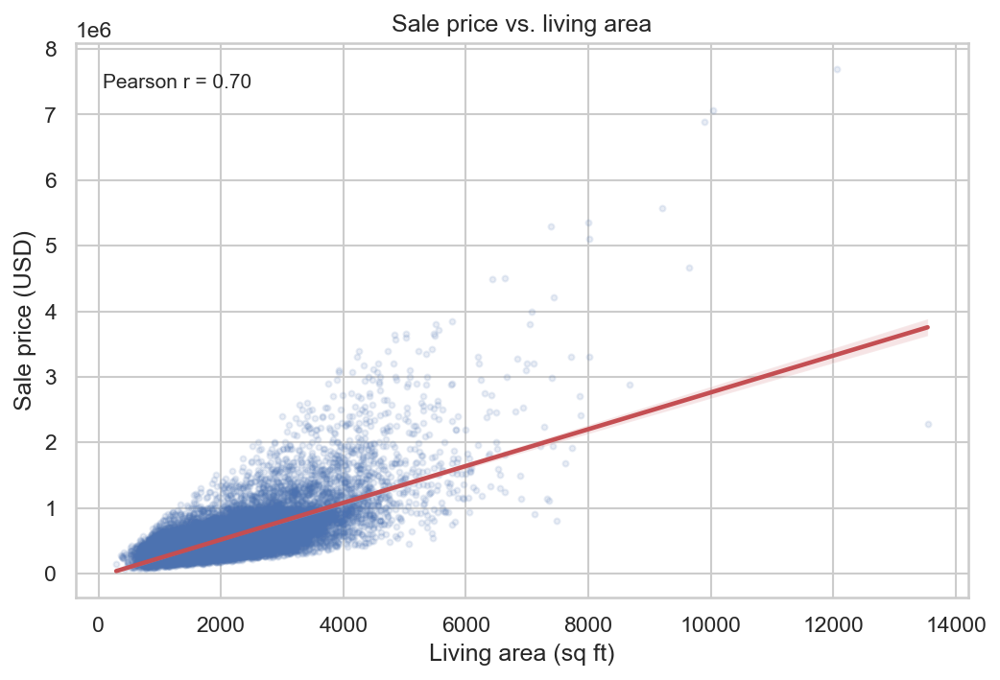
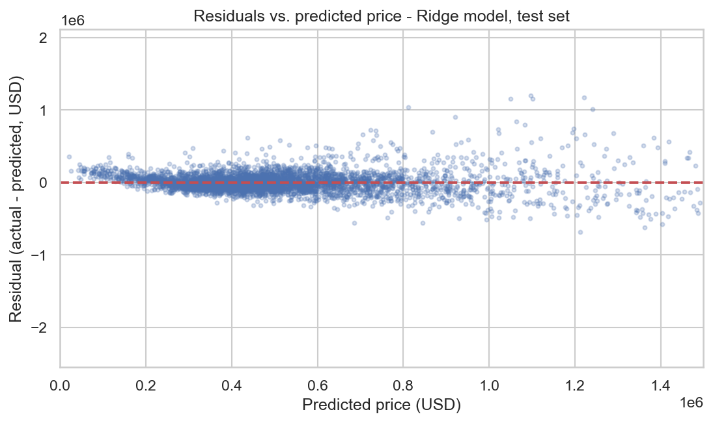

---
---

# WEN ZIMING (Justin Wen)

## Data Science Portfolio

Welcome! I am a Master of Science in Data Science student at the **University of
Macau**, with a strong interest in turning raw data into clear, reproducible
answers. This portfolio presents my data analysis work: the questions I ask, the
methods I use, and the visual evidence behind every conclusion.

**Contact / code:** [github.com/Empty-Imagination](https://github.com/Empty-Imagination)

---

## Technical skills

- **Programming:** Python, C++
- **Data analysis:** pandas, NumPy, feature engineering, data cleaning
- **Machine learning:** scikit-learn - regression, classification, model
  selection, cross-validation, evaluation metrics
- **Visualization:** Matplotlib, Seaborn, Plotly, Folium, Dash dashboards
- **Other exposure:** Hugging Face Transformers, OpenCV, SQL basics
- **Tools:** Jupyter, Git & GitHub, LaTeX

---

## Project showcase

### House Price Prediction in King County, WA

**Research question.** *Which property characteristics most strongly drive the
sale price of a house in King County, Washington - and how accurately can a
regression model predict the price of a house from those characteristics?*

The project analyses **21,613 house sales (May 2014 - May 2015)** with a complete,
reproducible pipeline: data cleaning, exploratory visualizations, three regression
models of increasing flexibility (multiple linear regression, degree-2 polynomial
regression, and Ridge regression tuned with grid search), and a rigorous
evaluation on a held-out test set.

**What the visualization shows.** Living area alone is already a strong signal
(Pearson r = 0.70), and the scatter fans outwards for larger, more expensive homes
- the first hint that prediction errors will grow with price.

**Key findings.**

- Location and size dominate: living area, building grade and geographic
  coordinates carry most of the price signal.
- A flexible model is worth it: test R^2 rises from about **0.69** for plain
  linear regression to about **0.78** for the polynomial and Ridge models, which
  predict an unseen sale with a typical error of about **$181,000** (RMSE).
- The model is weakest at the top of the market: the residual plot fans out for
  expensive homes, which is documented as the main limitation.

**Project artifacts.**

- **Repository (code, notebook, figures, README):**
  [Empty-Imagination/data-science-project](https://github.com/Empty-Imagination/data-science-project)
- **Status:** Completed - extended by an ongoing pair project that adds an
  interactive dashboard.

---

## About this site

This site is published with **GitHub Pages** directly from this repository's
`main` branch (`index.md` at the repository root is the website entry file). No
personal data, credentials or restricted datasets are published here.
